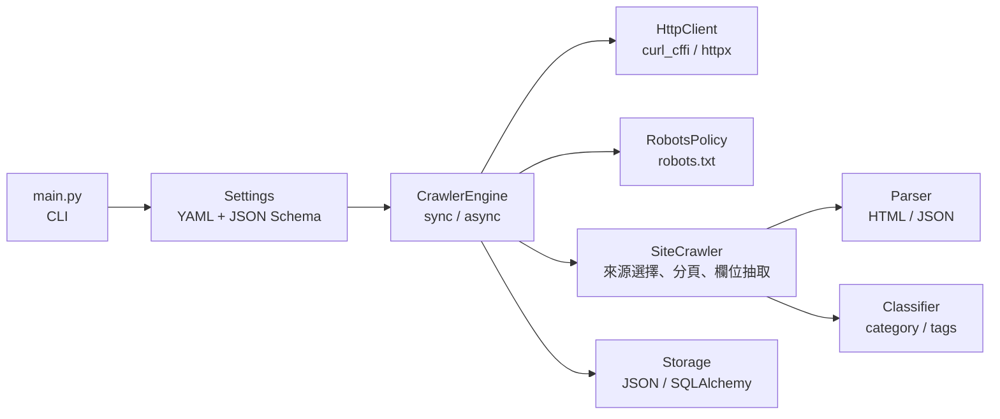

# Web Harvester

[](https://github.com/victor-900603/web-harvester/actions/workflows/ci.yml)
[](https://github.com/victor-900603/web-harvester)
[](LICENSE)

設定檔驅動的新聞爬蟲框架。**新增一個新聞站點只需要一份 YAML，不必改動程式碼。**

站點差異（列表 API、分頁方式、selector、欄位格式）全部收斂在 `config/sites/<name>.yaml`；
程式碼只實作通用流程：請求、重試、解析、去重、儲存。

## 為什麼是這個作法

- **站點差異留在設定層**：新增站點不必碰 Python，也不會出現十個 `if site == "..."` 的分支。
- **不依賴瀏覽器**：不引入 Playwright / Selenium。預設以 `curl_cffi` 模擬瀏覽器 TLS 指紋（JA3/Akamai）通過反爬，必要時可切回 `httpx`。
- **錯誤在啟動時就爆**：所有 YAML 以 JSON Schema 嚴格驗證（`additionalProperties: false`），打錯欄位名稱會立刻 `ConfigValidationError`，而不是安靜地爬回零筆資料。
- **可驗證**：304 個單元測試、覆蓋率 90%（CI 門檻 85%）、`ruff` 與 `mypy` 全綠，全部由 GitHub Actions 執行。

## 實際執行輸出

```console
$ python main.py --site udn_news --max-items 3
2026-10-29 16:50:43 [INFO] src.storage.database: Database engine initialized with URL: sqlite:///data/articles.db
2026-10-29 16:50:43 [INFO] src.core.engine: Starting crawler: 聯合新聞網 in sync mode
2026-10-29 16:50:44 [INFO] src.crawler.site_crawler: List page parsed: https://udn.com/api/more?page=1&... -> 20 link(s)
2026-10-29 16:50:49 [INFO] src.core.engine: Reached max_items limit of 3. Stopping.
2026-10-29 16:50:49 [INFO] src.core.engine: Total requests made: 4, total items collected: 3
2026-10-29 16:50:49 [INFO] src.core.engine: Crawler finished: 聯合新聞網
```

單筆輸出（完整範例見 [examples/sample_output.json](examples/sample_output.json)）：

```json
{
  "source": "聯合新聞網",
  "url": "https://udn.com/news/story/7240/9845109",
  "title": "台積電研發夜班計畫半年喊停 秦永沛揭40奈米挫折",
  "published_at": "2026-10-29T16:49:00",
  "author": "經濟日報/朱子呈",
  "category": ["產經"],
  "normalized_category": ["產經"],
  "tags": ["奈米", "台積電", "研發"],
  "crawler_at": "2026-10-29T08:50:45.972891+00:00"
}
```

## 功能特色

- **設定檔驅動**：透過 YAML 定義爬蟲行為，無需修改程式碼即可新增目標網站
- **雙執行模式**：支援同步（`sync`）與非同步（`async`）兩種模式
- **TLS 指紋偽裝**：基於 `curl_cffi` 的瀏覽器指紋模擬（JA3/Akamai），支援 `chrome`/`safari`/`firefox`/`edge` impersonate 與自訂 `ja3`/`akamai`，預設 `chrome131`
- **複合解析器**：可解析 HTML（BeautifulSoup）與 JSON 格式的列表頁與文章頁
- **多種儲存後端**：JSON 檔案、SQLite、PostgreSQL、MySQL（透過 SQLAlchemy）
- **分頁爬取**：支援頁碼（`{page}`）與游標（`{cursor}`）兩種分頁模式
- **增量爬取**：啟動時載入儲存後端已存的 URL，預設略過已知文章（`--no-skip-seen` 可關閉）
- **robots.txt 遵循**：請求前檢查目標網域的 robots.txt，預設開啟（`request.respect_robots`）
- **重試機制**：可設定最大重試次數，支援指數回退與 `Retry-After`（僅重試可重試錯誤）
- **跨站分類統一**：`category_normalization` 將各站分類對應到統一詞彙，便於跨站比對

## 架構



請求生命週期、去重鍵設計與各層職責詳見 [docs/architecture.md](docs/architecture.md)。

## 專案結構

```
web-harvester/
├── main.py                  # 主程式進入點（CLI）
├── requirements.txt         # 執行期依賴
├── requirements-dev.txt     # 開發與 CI 依賴
├── pyproject.toml           # ruff / mypy / pytest / coverage 設定
├── config/
│   ├── settings.yaml       # 全域設定（引擎、日誌、儲存）
│   ├── category_normalization.yaml  # 跨站分類統一對應表（Settings 自動合併）
│   ├── schema/             # 設定檔驗證 JSON Schema
│   └── sites/              # 站點設定（example / full_example 與 9 個新聞站）
├── docs/                   # site-config / global-config / logging / storage / architecture
├── src/
│   ├── core/               # 核心引擎（Engine、Request、Response、Item、HttpClient、Retry）
│   ├── crawler/            # 爬蟲邏輯（BaseCrawler、SiteCrawler、Classifier）
│   ├── parsers/            # 解析器（HTMLParser、JSONParser）
│   ├── storage/            # 儲存後端（JSON、Database）
│   └── utils/              # 工具函式（設定載入、日誌）
├── examples/               # 範例輸出
└── test/                   # 單元測試（pytest）
```

## 安裝

```bash
python -m venv .venv
.venv\Scripts\activate      # Windows
source .venv/bin/activate   # macOS / Linux

pip install -r requirements.txt
```

## 快速開始

```bash
python main.py --list-sites          # 列出可用站點
python main.py --site udn_news       # 執行內建範例（聯合新聞網）
```

### CLI 選項

| 參數 | 說明 |
|------|------|
| `--site <name>` / `-s` | 指定站點 ID（對應 `config/sites/<name>.yaml`） |
| `--list-sites` / `-l` | 列出所有站點後退出 |
| `--keyword <kw>` / `-k` | 關鍵字搜尋（需站點設定支援 `{keyword}` 的來源） |
| `--category <名稱>` / `-c` | 分類篩選（需站點設定 `categories`） |
| `--max-items N` | 覆寫 `limits.max_items` |
| `--max-pages N` | 覆寫 `limits.max_pages` |
| `--stop-on-duplicate` / `--no-stop-on-duplicate` | 覆寫 `limits.stop_on_duplicate` |
| `--timeout SEC` | 覆寫 `limits.timeout` |
| `--skip-seen` / `--no-skip-seen` | 覆寫 `engine.skip_seen_urls`（是否略過已存的 URL） |

關鍵字與分類可組合使用：

```bash
python main.py --site udn_news --keyword 台股
python main.py --site udn_news --category 股市
python main.py --site udn_news --keyword 台股 --category 股市
```

## 新增一個站點

只需要新增 `config/sites/<name>.yaml`，程式碼與 CLI 都不用改：

```yaml
name: "example"
base_url: "https://example.com"

list_page:
  sources:
    - url: "https://example.com/news?page={page}"
      type: "html"
      extract:
        item_selector: "article.news-item"
        link_selector: "a"
        link_attr: "href"
      pagination:
        enabled: true
        start: 1

article_page:
  type: "html"
  fields:
    title: "h1.article-title"
    content:
      as: "text"
      selector: "div.article-body"
      attr: "text"
    published_at:
      as: "datetime"
      selector: "time.publish-date"
      attr: "datetime"
      datetime_format: "%Y-%m-%dT%H:%M:%S"
    author:
      as: "text"
      selector: "span.author-name"
      attr: "text"
```

```bash
python main.py --site example
```

設定不符 schema 時會在啟動階段立即失敗並指出欄位路徑。完整欄位、POST `body`/`json_body`、游標分頁、`url_filter`、分類與標籤來源請見 [docs/site-config.md](docs/site-config.md)。

## 設定說明

| 文件 | 內容 |
|------|------|
| [docs/site-config.md](docs/site-config.md) | 站點設定全欄位、來源選擇決策、分頁、分類與標籤、常見驗證錯誤 |
| [docs/global-config.md](docs/global-config.md) | 引擎、limits 四層優先權、HTTP client、重試 |
| [docs/logging.md](docs/logging.md) | 日誌等級、格式、輪替 |
| [docs/storage.md](docs/storage.md) | JSON 與資料庫儲存設定 |
| [docs/architecture.md](docs/architecture.md) | 分層職責、請求生命週期、去重與增量設計、robots.txt 檢查 |

`limits` 最終值採四層合併（後者覆寫、略過 None）：
**CLI 參數 > site `limits` > settings `limits` > 程式碼預設**。

## 資料庫結構

資料存入 `articles` 資料表，主要欄位如下：

| 欄位 | 類型 | 說明 |
|------|------|------|
| `source` | String | 來源網站名稱 |
| `url` | String | 文章網址（唯一） |
| `title` | String | 標題 |
| `author` | String | 作者 |
| `published_at` | DateTime | 發布時間 |
| `content` | Text | 文章內容 |
| `category` | Text | 分類（JSON 陣列） |
| `normalized_category` | Text | 統一後分類（JSON 陣列，跨站比對用） |
| `tags` | Text | 標籤（JSON 陣列） |
| `crawler_at` | DateTime | 爬取時間（UTC） |
| `extra_data` | Text | 額外資料（JSON 格式） |

去重機制：寫入前先以 `url` 查詢是否已存在（`data.url` 優先於 `item.url`），存在則跳過；
`url` 欄位另有 unique 約束做第二層防護，若併發插入撞約束會捕獲 `IntegrityError` 後跳過，不會中斷爬取。
列表層級另有請求去重，鍵值包含 method、URL、body 與 json_body，避免 POST 分頁被誤判為重複。

啟用 `engine.skip_seen_urls` 時，引擎會在啟動階段以各儲存後端的 `known_urls()` 取得已存網址，
列表解析出的已知文章直接跳過，不發出請求；搭配 `stop_on_duplicate` 可在遇到第一筆已知文章時收手，
適合「只補抓最新幾篇」的定期執行。

## 開發與測試

```bash
pip install -r requirements-dev.txt

pytest                    # 337 passed
pytest --cov              # 覆蓋率 90%（門檻 85%）
ruff check src main.py test
mypy
```

單元測試不連真實網路：engine 測試透過 monkeypatch `CrawlerEngine._process_sync` / `_fetch_async` 模擬回應；
storage 測試使用 pytest 的 `tmp_path` 暫時目錄。CI（GitHub Actions）在每次 push 與 PR 執行 lint、type check 與測試。

## 與其他工具的差異

| 工具 | 定位 |
|------|------|
| `trafilatura` | 專注單頁內文抽取，不處理多站列表、分頁與儲存流程 |
| `news-please` | 內建站點規則為主，新增站點通常需改動程式碼或既有規則 |
| Crawlee | 生態完整但需 Node 與瀏覽器，適合重度 JavaScript 站點 |
| 本專案 | 多站、YAML 驅動、無瀏覽器相依，適合固定站點的新聞批次收集 |

## 已知限制

- 不執行 JavaScript，需要瀏覽器渲染的 SPA 站點不適用
- 站點改版後需自行維護 selector 與列表來源
- 單機執行，尚無分散式排程
- 未處理登入、付費牆與驗證碼
- 非同步模式的 `max_items` 為近似上限：worker 並行時，實際收集數可能略超過設定值
- `request.respect_robots` 預設開啟；`tvbs` 站點因其列表 API 的 robots.txt 為 `Disallow: /`，在設定檔中明確關閉，使用前請自行判斷
- 仍應自行確認目標站點的使用條款

## 依賴套件

| 套件 | 用途 |
|------|------|
| `curl_cffi`（預設）/ `httpx`（備援） | HTTP 請求與 TLS 指紋偽裝 |
| `beautifulsoup4` + `lxml` | HTML 解析 |
| `PyYAML` | 設定檔讀取 |
| `jsonschema` | 設定檔 Schema 驗證 |
| `SQLAlchemy` | 資料庫 ORM |
| `colorlog` | 彩色日誌輸出 |
| `celery` + `redis` | 非同步任務佇列（目前未使用，保留備用） |

## Roadmap

以下項目尚未實作：

- 整合 Celery 以支援分散式任務處理
- 設計與實作 Middleware 機制以增強爬蟲靈活性
- 定時排程（目前增量爬取需由外部 cron 觸發）

## 授權

[MIT](LICENSE)
